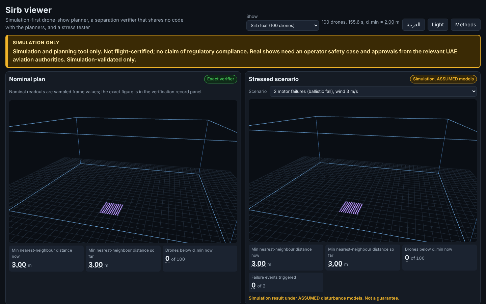
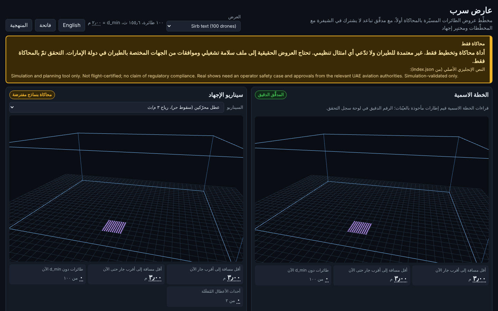
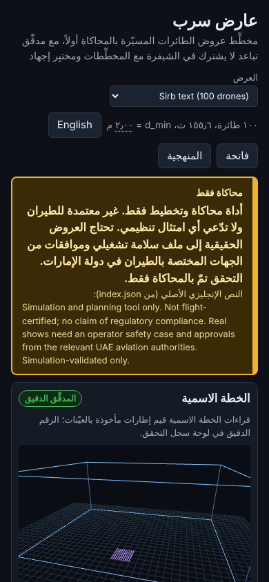

# Sirb (سرب)

> **SAFETY STATEMENT. Simulation and planning tool only. Not flight-certified. No claim of regulatory compliance. No flight-control, radio or MAVLink code; exports are files labeled "simulation-validated only". A real drone show needs an operator safety case and approvals from the relevant UAE aviation authorities. There is no real flight data behind any result in this repository.**

[](https://github.com/hudasol/sirb/actions/workflows/ci.yml)

*Sirb* is Arabic for "flock" or "squadron".

A simulation first suite that turns shape sequences into multi drone show trajectories, checks them with an exact separation verifier that shares no logic with the planners, stress-tests them in Monte-Carlo simulation against wind, GNSS degradation, drone failures and comms/battery events, and writes a report with the measured margins.

> **Safety statement.** Sirb is a simulation and planning research tool. It is **not flight-certified** and makes **no claim of regulatory compliance**. It has no flight-control, radio or MAVLink code and cannot command real aircraft; exports are files labeled "simulation-validated only". A PASS verdict means only that the polynomial paths as written satisfy the limits declared in the show file; it is not an approval, a safety case or evidence that a real show is safe. A real drone show needs an operator safety case and approvals from the relevant UAE aviation authorities. There is no real flight data behind any result here.

## Status

Built, tested and self reviewed (nobody outside the project has reviewed it): show spec and shapes, assignment, three planners, the exact verifier and its verification record, a second independent verifier used for differential testing, the Monte Carlo stress simulator with contingency behaviours, the pre-flight consistency validator, the bilingual viewer, file export, a command line, a hazard analysis, a versioned GNSS parameter file format, and the critique rounds in `docs/REVIEW_ROUNDS.md`. Predictions were written before the later experiments and graded in `docs/PREDICTIONS.md`.

Live viewer: https://hudasol.github.io/sirb/ (served by GitHub Pages from `viewer/`; it works only after Pages source is set to "GitHub Actions" in the repository settings and the workflow in `.github/workflows/pages.yml` has run). To run it locally: `python -m http.server -d viewer 8000`.

**Sensitivity statement.** Every stressed verdict hinges on a single unsourced parameter: the GNSS bias that is not shared between nearby drones (relative error). Public sources give the absolute error of one receiver, and one literature value for the error left after common mode cancellation on other hardware; none measures it between show drones, so it stays an assumption (`docs/GNSS_SOURCED.md`).

Not done: field or flight validation of any kind, regulatory work, and the exploratory ground robot study is a proposal seed only (`docs/GROUND_ROBOTS.md`). A funded indoor validation is proposed, not started (`docs/PROPOSAL_SEED.md`). See `docs/NEXT_STEPS.md`.

## Headline numbers (generated from `results/*.json`)

<!-- HEADLINES:START -->
- Demo show `sirb_text_100` (100 drones, 156 s): exact verified minimum separation 2.189 m against d_min 2.0 m, verdict PASS (model: drones as points on the planned polynomials).
- Demo show `torus_300` (300 drones, 107 s): exact verified minimum separation 2.196 m against d_min 2.0 m, verdict PASS (model: drones as points on the planned polynomials).
- Demo show `wall_500` (500 drones, 132 s): exact verified minimum separation 2.448 m against d_min 2.0 m, verdict PASS (model: drones as points on the planned polynomials).
- Simulated wind (ASSUMED models), 100 drone show: highest tested wind with a Wilson upper bound at most 5%: 12 m/s at 20 ft; first tested wind with an observed violation: 15 m/s. This is not a wind limit: the model has no actuator limit, the sweep goes beyond the vehicle's published wind limit, and the value moves with the tracking and GNSS assumptions (`docs/SENSITIVITY.md`).
- Simulated GNSS bias (25% of drones degraded, ASSUMED): P(violation) exceeds 5% already at bias sigma 0.1 m (35.5%); the nominal margin over d_min is only 0.189 m.
- Smallest tested formation spacing in the stated scenario whose Wilson upper bound is at most 5%: 5.0 m, nominal separation 3.54 m (300 trials, a coarse grid of spacings; the margin tool's search answer is in `docs/MARGIN.md`).
- Contingency runs: largest bystander to bystander violation rate over all rows: 0.0%. Violations involving the drone that had the event are common: up to 99.5% (gnss_dropout 10% x 10 s, descend), with contact (centres within two drone radii) up to 62.0%.
- Stress study scaling: largest verified size n = 1000: plan 7.9 s + exact verification 98.1 s (wall clock on a shared machine; not comparable with `docs/PERFORMANCE.md`). Sizes 2000 did not verify because the shapes exceed the altitude band (a limit of the test shapes, not a timing result).
<!-- HEADLINES:END -->

## Verification evidence (generated from `results/*.json`)

<!-- ASSURANCE:START -->
- Second, independent verifier (interval branch and bound, `sirb/verify2.py`): 10856 fleets (8000 random, 2750 adversarial in 11 families), 13100 verdict checks: lower bound above the exact value in 0 cases (max l minus e = 0.0e+00 m), FAIL verdicts with the exact value at or above the threshold: 6 (max margin 0.0e+00 m); 30 disagreement records, all in the high multiplicity root family, largest exact minus lower bound 7.3e-08 m (`docs/VERIFIER.md`). Brute force sampling at dt = 1e-4 s against the exact value: 3034 comparisons, largest sampled minus exact 1.1e-08 m (grid plus breakpoints), largest negative gap 3.6e-15 m.
- Mutation testing (mutmut, killed over total): fresh phase 6 run on the current code: `assign.py` 93.0% of 314; `planner/baseline.py` 98.4% of 188; `planner/common.py` 95.4% of 196; `planner/prioritized.py` 82.8% of 682; `planner/waves.py` 90.0% of 450; `verify.py` 92.9% of 2383; `verify2.py` 95.3% of 988. (`docs/MUTATION.md`).
- Viewer accessibility (axe-core 4.14.0, 8 page runs): 18 violated rules before, 0 after; this is an automated check and does not replace manual testing.
- Viewer behaviour checks (keyboard, reduced motion, light theme, file protocol, RTL, overflow): 40 passed, 0 failed.
- Scale (computational study): n = 4000: plan 233 s, exact verification 164 s, peak memory 665 MB (`docs/PERFORMANCE.md`).
- Viewer, 1000 drones, two panes, software WebGL: median frame interval 317 ms (3.2 fps), JavaScript update p95 1.2 ms; smoothness on a GPU is not measured.
- Largest one at a time swings of the median minimum separation (stressed baseline): gnss_bias_sigma (1.57 m), gnss_deg_fraction (0.43 m), gnss_bias_tau (0.09 m) (`docs/SENSITIVITY.md`).
<!-- ASSURANCE:END -->

What these checks are and are not: they show that two implementations with different methods agree on large random and adversarial sets, that the test suite detects most small code changes, and that the viewer passes an automated accessibility scan. They do not prove the verifier correct, and the first two are statements about the plan as written, not about aircraft.

## Screenshots

| English, desktop | Arabic (right to left), desktop | Arabic, phone width |
|---|---|---|
|  |  |  |

Demo video frame list (about 75 s, script in `docs/DEMO_SCRIPT.md`): 1. title and safety banner; 2. both panes playing at 4x; 3. separation colouring; 4. verification record and Methods link; 5. motor failure scenario; 6. Arabic toggle and sim to real gap.

## What the evidence supports

- The verifier is **independent in code and method** from the planners (exact polynomial root finding versus planner-side sampling; `sirb/verify.py` imports nothing from Sirb). It is **not independent in authorship**: the same people wrote both, and nobody outside the project has reviewed it. Its guarantee is exact minimum separation and limit checks for the trajectories *as written*, under the declared model (drones are points; limits come from the show file, many of which are labeled assumptions).
- On the four demo shows, Hungarian assignment with synchronous straight line legs already verifies (`results/planners.json`). The wave scheduler and the prioritized planner match it there, and **neither produced a plan on the deliberately crossed `pinned15` assignment in any of the four shows** (wave scheduling got stuck; prioritized hit its 30 s budget). The benchmark therefore does not show that the stronger planners add capability.
- Stress-test probabilities are properties of the simulated model with assumed parameters (`docs/METHODS.md`, sections 5 and 9). They are not real-world risk. Several sweeps go beyond the vehicle's published wind limit and the model has no actuator limit; read the caveats in METHODS section 5 before quoting any row.
- Limited search novelty claim: the project found no open source drone show tool that publishes separation margins under modelled GNSS error or ships a verifier independent of the planner. That search was limited (`docs/RESEARCH.md` section 1.4).

Terminology: the "certificate" Sirb writes is a machine-readable verification record of what the exact verifier computed. It is not an airworthiness certificate, an approval or a safety clearance; the viewer calls it a verification record. A verdict is `PASS` only if nothing failed and every limit family was supplied (otherwise `INCOMPLETE`).

## Quickstart

```
pip install -c constraints.txt -e ".[dev]"   # exact versions used for the recorded results
pytest -q && ruff check .

python -m sirb validate shows/sirb_text_100.json
python -m sirb plan shows/sirb_text_100.json --out /tmp/export.json   # plan + verify + export bundle
python -m sirb check /tmp/export.json                                 # re-check hash and certificate

python -m http.server -d viewer 8000     # viewer at http://localhost:8000/ (must be served over HTTP)
```

Exit codes: 0 ok, 1 invalid or tampered input, 2 the plan verified but failed a declared limit. The check on an export detects accidental change (hash plus recomputation); it is **not authentication**, because anyone who edits a file can also recompute its hash.

Reproduction: `make reproduce` runs install, tests, demo shows, planner benchmark, viewer data and the stress experiments with fixed seeds. On Windows without `make`, run the `python scripts/...` lines from the `Makefile` in the repository root. `make reproduce` covers the core experiments; the phase 6 studies (sensitivity, sourced GNSS, margin, scaling profile, differential report) are run by `scripts/run_phase6_chain.sh`. Planned fleets are identical across machines (`docs/REPRODUCIBILITY.md`). Other numbers are deterministic on one machine given the library versions, with three exceptions: wall clock fields (`*_runtime_s`, `wall_s`, `*_cpu_s`) differ between runs; the prioritized and grid planners stop at a wall clock time budget, so on a much slower machine they may give up where they succeeded here; and the near degenerate verifier cases and Monte Carlo last bits depend on the CPU dispatched LAPACK build (`results/platform_probe/`).

## Layout

| Path | Purpose |
|---|---|
| `sirb/spec.py`, `shapes.py` | show file, validator, procedural shapes |
| `sirb/assign.py`, `planner/` | assignment methods; baseline, wave and prioritized planners |
| `sirb/verify.py`, `certificate.py` | exact verifier and reproducible certificate |
| `sirb/disturbance.py`, `stress.py`, `contingency.py` | Monte Carlo stress model |
| `sirb/preflight.py`, `export.py`, `cli.py` | consistency validator, file export, command line |
| `sirb/margin.py` | planning aid: nominal separation for a simulated risk target (`python -m sirb margin`) |
| `data/` | the one external table used (FAA GPS accuracy statistics, US government work) |
| `viewer/` | static three.js viewer, English/Arabic |
| `docs/` | phase 6: `OVERNIGHT_REPORT.md`, `MARGIN.md`, `GNSS_SOURCED.md`, `REPRODUCIBILITY.md`, `CHANGES.md`, reviewer briefs `BRIEF_*.md` and `SUMMARY_AR.md` (Arabic, needs native review); earlier: `HAZARDS.md`, `PREDICTIONS.md`, `MUTATION.md`, `PERFORMANCE.md`, `SENSITIVITY.md`, `GNSS_PARAMS.md`, `RESULTS.md`, `REPORT.md`, `PROPOSAL_SEED.md`, `METHODS.md` (assumptions and sim-to-real gap), `VERIFIER.md`, `SHOW_SCHEMA.md`, `RESEARCH.md`, `DATA_SOURCES.md`, `REVIEW_ROUNDS.md` |

## Limitations

Simulated drones follow a simplified vehicle model. Vehicle numbers come from published datasheets where available and are labeled assumptions otherwise; in particular the 2.0 m separation threshold is an assumption, while the 50 m crowd buffer follows cited guidance whose UAE applicability was **not verified**. GNSS position-domain error parameters are assumptions. Wind uses Dryden-intensity turbulence built for piloted aircraft. See `docs/RESEARCH.md` sections 3 and 5 and `docs/METHODS.md` section 9.

## Related work

`hudasol/marsad` (GNSS position trust) and the Gulf GNSS interference project are separate repos. No coupling exists: Sirb reads GNSS parameters from a versioned file (`docs/GNSS_PARAMS.md`), and neither project currently publishes position error statistics in a form that file can use. They are not modified or imported.

## License

MIT for Sirb's own code today. Third party licences: `docs/DATA_SOURCES.md`. A proposal to move code to Apache-2.0 and documentation and data to CC BY 4.0 is in `docs/LICENSE_PROPOSAL.md` (the owner decides).
